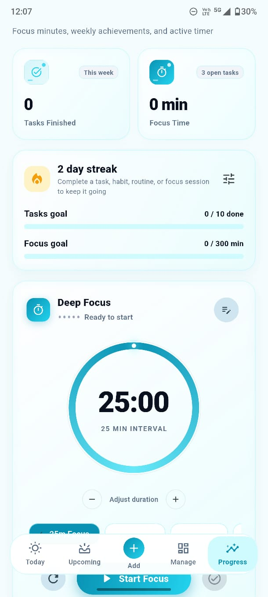
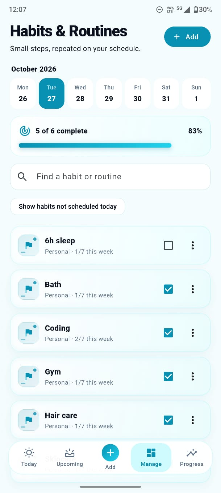
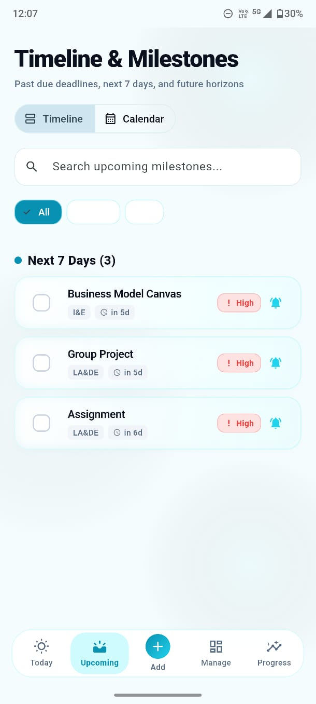
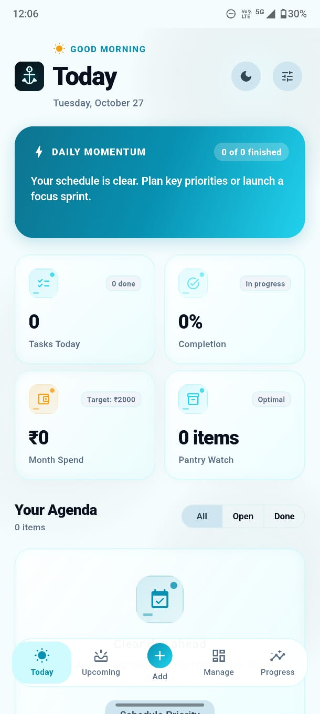

# Anchor Hub

**A calm, colorful workspace for your day.** Anchor Hub brings tasks, habits, focus sessions, spending, pantry tracking, and shopping lists together in one Flutter app.

The interface uses a clean cyan-and-white light theme with a matching dark theme. Your information is saved locally on the device or browser; the app does not require an account or cloud service.

## Screenshots

<table>
  <tr>
    <td align="center"><strong>Today</strong><br><a href="ss/today-dashboard.jpeg"></a></td>
    <td align="center"><strong>Upcoming</strong><br><a href="ss/upcoming-calendar.jpeg"></a></td>
  </tr>
  <tr>
    <td align="center"><strong>Habits &amp; routines</strong><br><a href="ss/habits-and-routines.jpeg"></a></td>
    <td align="center"><strong>Focus &amp; progress</strong><br><a href="ss/focus-and-progress.jpeg"></a></td>
  </tr>
</table>

## What you can do

- **Plan your day:** Review today's agenda, completion progress, spending, and pantry alerts from the dashboard.
- **Manage deadlines:** Search and filter tasks, set priorities, schedule recurring tasks, and browse an upcoming timeline or calendar.
- **Build routines:** Create habits with repeat days or step-by-step routines, record check-ins, and follow weekly completion and streaks.
- **Focus with intention:** Use 5, 15, 25, or 50 minute focus sessions and track weekly focus time and task goals.
- **Track money:** Record expenses, set a monthly budget, and switch between INR and USD using an editable exchange estimate. Rates are not fetched live.
- **Keep home lists:** Track pantry quantities and expiry dates, and add items to a searchable shopping list.
- **Stay on top of reminders:** Android can schedule task and pantry notifications for 9:00 AM. Task reminders are tied to due dates; pantry reminders can be scheduled up to three days before expiry. Notification permission is required, and Android battery settings may delay inexact notifications.
- **Make it yours:** Switch between light and dark themes, adjust app settings, and use onboarding and accessible controls designed to respect reduced-motion preferences.
- **Back up your data:** Export or restore a versioned JSON backup, including recurring tasks, shopping lists, and habit history.

## Data and platform notes

- Data is stored locally on the current device. There is no account or cloud synchronization.
- The web build stores data in the current browser and does not schedule future local reminders. Browser data does not sync with Android.
- Android reminders are local notifications. Their delivery depends on notification permission and device power-management settings.

## Run the app

### Requirements

- Flutter SDK with a Dart version compatible with the constraint in `pubspec.yaml`
- Android Studio and Android SDK for Android builds
- An Android emulator or a USB-connected Android phone for device testing

### Run on Android

From the project directory:

```sh
flutter pub get
flutter devices
flutter run -d <device-id>
```

Replace `<device-id>` with the Android device ID shown by `flutter devices`. Keep the terminal open while the app runs; press `r` in the terminal for hot reload.

### Run in a browser

```sh
flutter pub get
flutter devices
flutter run -d chrome
```

You can use another browser device ID reported by `flutter devices`. Keep the terminal running during development; press `r` if a saved change does not reload automatically.

### Build an Android APK for testing

```sh
flutter build apk --debug
```

The APK is created at `build/app/outputs/flutter-apk/app-debug.apk`. Copy it to your phone and install it, or run the app directly on a connected phone with `flutter run`.

### Prepare a signed release

For a distributable release or Google Play upload, create an upload keystore and copy `android/key.properties.example` to `android/key.properties`. Fill in the keystore path and passwords; never commit the keystore or `key.properties`. Back up the keystore and passwords securely because future app updates need the same signing key.

Build an APK or Play App Bundle after configuring signing:

```sh
flutter build apk --release
flutter build appbundle --release
```

The outputs are written to `build/app/outputs/flutter-apk/app-release.apk` and `build/app/outputs/bundle/release/app-release.aab`. Increase the build number in `pubspec.yaml` for each release.

## Project layout

| Path | Purpose |
| --- | --- |
| `lib/main.dart` | App startup, recovery, theme, and root widget |
| `lib/screens/` | Today, Upcoming, Manage, Progress, and onboarding screens |
| `lib/widgets/` | Reusable cards, dialogs, interactions, and focus timer |
| `lib/models.dart` | Task, expense, pantry, habit, settings, and focus models |
| `lib/hub_state.dart` | App state, local persistence, and backup/restore |
| `lib/reminder_service.dart` | Android task and pantry reminder scheduling |
| `android/` and `web/` | Platform-specific configuration |
| `ss/` | App screenshots used in this README |

## Development checks

```sh
flutter analyze
flutter test
```

## Ideas for future work

- Habit and routine reminder schedules
- A file-based backup and restore flow, with optional encrypted exports
- More accessibility checks and end-to-end testing on Android devices
